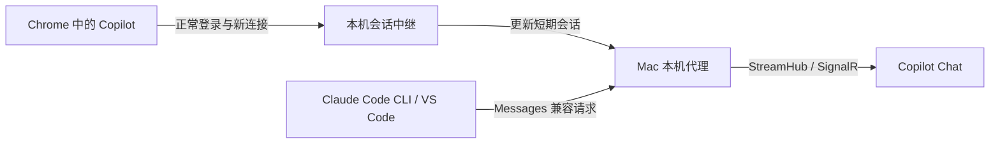

# Copilot Mac Proxy

在 **macOS** 上，将本人正常可用的 Microsoft 365 Copilot Chat 会话接入本机 Claude Code。提供本机 Messages 兼容接口、Chrome 会话中继扩展和 macOS LaunchAgent 管理。

已在 Apple silicon Mac 上验证 Opus 5.5 和 Fable 5.1 的文本与 Read 工具往返。Intel Mac 尚未实测。项目不提供账号、模型权限或访问令牌；模型必须已在使用者自己的 Copilot 界面中可用。

## 工作方式



本项目使用 **Copilot Chat 的 StreamHub 协议**。参考项目 [copilot-app-proxy](https://github.com/madderscientist/copilot-app-proxy) 面向 Windows Copilot Code 的 Loki Messages 接口；两者的运行环境和上游协议不同。

**这不是原生 Anthropic API。** 代理将 system、历史、工具定义及工具结果封装成文本，再将模型返回的 JSON 解析为 Claude Code 工具调用。工具执行与确认仍由 Claude Code 负责。详见[协议与数据流](docs/architecture.md)。

## 准备

- macOS、Node.js 22 或更新版本、npm、Python 3.9 或更新版本。
- 已安装 Claude Code CLI；VS Code 用户可同时安装官方 Claude Code 扩展。
- Chrome 中可以正常使用 [Microsoft 365 Copilot Chat](https://copilot.cloud.microsoft/home)，并能选择所需的两个模型。
- 初次导入需要从本人正常会话导出的 HAR，其中包含两个模型的 WebSocket 请求帧。

本地代理默认仅监听 `127.0.0.1:19324`。安装与管理不需要管理员权限。

## 安装

在仓库目录执行：

```bash
npm ci
python3 manage.py setup
```

安装程序会在当前用户的 `~/Library/Application Support/CopilotMacProxy` 下创建独立运行目录，并生成本机密钥、启动配置和 native host 模板。已有安装目录不会被覆盖。此步骤不启动服务、不注册浏览器宿主，也不修改 Claude Code 设置。

### 1. 导入首次会话

1. 在 Chrome 打开 Copilot，正常登录。打开开发者工具的 **Network** 面板，开始记录并启用 **Preserve log**。
2. 刷新页面，使 Network 记录到新的 WebSocket 连接。选择 Opus，在临时聊天中发送一条简短测试消息，例如“只回复 OK，不搜索、不读取文件、不使用工具”。
3. 选择 Fable，使用同样的测试消息。保留这两次请求的记录。
4. 将记录导出为本地 HAR。文件需要包含 StreamHub WebSocket 条目的 `_webSocketMessages`，其中能找到两个 `chat_request` 帧。导入器缺少任一模型证据时会拒绝导入。
5. 收紧 HAR 权限并导入：

```bash
chmod 600 /path/to/copilot-capture.har
python3 manage.py import-har /path/to/copilot-capture.har
```

HAR 即使标为 **sanitized**，也可能在 WebSocket URL 中包含访问令牌。不要上传到 GitHub、Issue 或聊天；导入并确认可用后，删除原始 HAR。导入器仅保留必要会话字段和已观察到的模型映射，不保留聊天历史或响应内容。

当前映射为：

| Claude Code 模型 ID | Copilot 请求中的 tone |
|---|---|
| `copilot-claude-opus-5.5` | `Claude_Container` |
| `copilot-claude-fable-5.1` | `Claude_Fable` |

显示名称和 tone 必须由使用者自己的界面及请求记录对应确认。若服务改名或协议变化，不应通过猜测模型 ID 来扩大访问范围。

### 2. 安装会话中继扩展

```bash
python3 manage.py register-host
```

在 `chrome://extensions` 打开开发者模式，选择“加载未打包的扩展程序”，打开：

```text
~/Library/Application Support/CopilotMacProxy/extension
```

确认 **Local Copilot Session Relay** 已启用。若同名 native host 已指向另一套安装，管理脚本会拒绝覆盖；应先处理已有安装，再注册本项目。

扩展仅观察 Copilot 正常发起的目标 WebSocket 握手，并把短期会话交给本机 native host。它不读取 Cookie、请求正文或 WebSocket 消息，不使用内容脚本。权限和消息协议见[扩展说明](extension/README.md)。

### 3. 启动并接入 Claude Code

```bash
python3 manage.py start
python3 manage.py status
python3 manage.py configure-claude
claude --model opus
```

也可以使用 Fable：

```bash
claude --model fable
```

配置命令会保存原设置备份，写入本机网关地址、密钥和模型映射。重新打开已有 Claude Code 会话后生效。代理会在当前用户登录后启动。

## 会话更新与重启

- **凭据有效时**，可关闭 Chrome，直接使用 Claude Code。
- **凭据过期后**，在安装扩展的同一 Chrome 配置文件中打开或刷新 Copilot，必要时正常登录或发送简短消息。新连接被观察到后，代理会热加载会话。
- **重启后**，代理可复用尚有效的本机会话；若已经过期，仍需通过 Chrome 更新。

扩展不会自行登录、获取 refresh token 或主动续期。它同步的是 Copilot 正常获得的会话；连续两次同步可能具有相同的到期时间。只打开 Teams 或独立 Copilot 桌面 WebView 不会触发 Chrome 扩展。

## 界面兼容性

| 客户端 | 状态 |
|---|---|
| Claude Code CLI | 已验证两个模型的 Read 工具往返 |
| VS Code 官方 Claude Code 扩展 | 可使用同一本机 Messages 网关；图形界面完整工作流未逐项验证 |
| Claude 桌面 App 的 Code 页 | 需要独立第三方推理配置，本项目未实测 |
| Codex | 当前不支持；本项目没有 `/v1/responses` 兼容层 |

VS Code 若仍使用旧地址，检查扩展的 `claudeCode.environmentVariables` 是否覆盖了 Claude Code 用户设置。本项目管理脚本仅管理 Claude Code 用户设置，不自动改写 VS Code 配置。

## 能力范围

- 运行时已验证 Claude Code 的默认 system/工具集下 `Read → tool_result → 最终答案` 两轮流程；没有验证所有工具、长任务、动态工具加载或并行子代理。
- 支持文本；图片、部分新内容块、`stop_sequences` 和显式结构化输出不支持。
- SSE 在完整响应解析后输出，等待期间发送 ping，不是逐 token 上游流。
- token 数与客户端费用显示是估算，不是 Copilot 实际账单。
- 本地文本上限为 200,000 字符；建议使用保守上下文，不能据此宣称支持 1M 上下文。
- `max_tokens`、effort 和缓存行为不能等价映射。
- 客户端断开连接不保证云端推理立即停止。
- 此服务接口可能随上游更新而变化。

## 管理与测试

```bash
python3 manage.py status
python3 manage.py stop
python3 manage.py start
python3 manage.py restore
node --test
python3 -m unittest discover -s tests
```

`stop` 停止服务并停用该用户的自动启动项；`start` 可再次加载。`restore` 恢复脚本管理的 Claude Code 配置并停止服务，保留无关的后续设置；它不会删除会话或卸载扩展。需要停用会话中继时，在 Chrome 扩展页停用或移除该扩展。

协议层包含 24 项离线测试，使用合成会话，不需要真实账号或上游凭据。测试覆盖文本封装、模型会话选择、私有快照、native messaging 和本机热加载；不代表对上游所有功能的兼容保证。

## 凭据与公开内容

运行时的 `session.json` 含短期访问令牌及必要账号路由信息，以 `0600` 文件权限保存在 `0700` 私有目录内；这是权限保护，不是加密存储。请求内容会发送至 Copilot 上游。

仓库仅包含可审阅源码、通用配置模板和合成测试。不要提交运行目录、HAR、网关密钥、Claude 设置、服务日志或截图。扩展 manifest 的 `key` 是用于稳定扩展 ID 的公钥，不是访问凭据。

第三方来源与依赖见 [THIRD_PARTY_NOTICES.md](THIRD_PARTY_NOTICES.md)。
