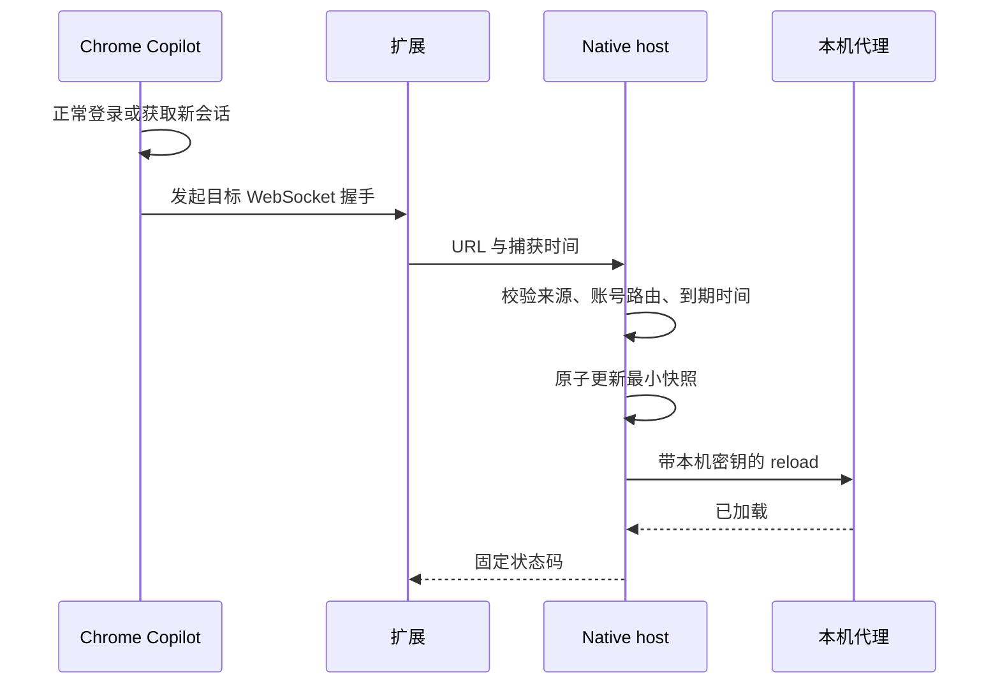

# 协议与数据流

Copilot Mac Proxy 在 macOS 上运行独立的本机 HTTP 网关。客户端使用 Messages 风格请求，上游使用实际捕获到的 Copilot Chat StreamHub/SignalR 会话。

## 请求链路

1. Claude Code 向 `127.0.0.1:19324` 发送带本机网关密钥的请求。代理拒绝非本机 Host、带浏览器 Origin 的请求及缺少认证的模型调用。
2. `envelope.mjs` 检查消息和工具结构，将 system、历史、工具定义及工具结果编码为文本。未知或不支持的内容块会失败，不会静默转换为工具执行。
3. `streamhub.mjs` 为每个请求生成新的会话与请求标识，连接固定的 TLS 上游。模型 tone 必须来自导入时已观察到的请求。
4. 上游最终文本按严格 JSON 规则解析。工具名称必须已由客户端声明；本地代理仅返回工具请求，不执行工具。
5. Claude Code 按自身权限规则执行工具，再将结果送回代理。完整上游响应解析后，代理输出 Messages 格式结果或 SSE 事件。

上游请求不附加捕获会话中的插件、连接器或历史文件。每轮发送的客户端历史仍包含在本轮文本封装中。

## 接口

| 路径 | 用途 |
|---|---|
| `GET /healthz` | 本机运行状态、缓存到期时间和活动请求数 |
| `GET /v1/models` | 当前两项模型映射，需要本机认证 |
| `POST /v1/messages` | 文本与工具封装请求，需要本机认证 |
| `POST /v1/messages/count_tokens` | 估算文本 token 数，需要本机认证 |
| `POST /_internal/reload` | 重新加载私有快照，需要本机认证 |

`healthz` 返回正常只说明本地进程运行，缓存到期时间也不能证明上游仍接受令牌。实际模型请求才验证远端授权。

## 首次导入

Chrome HAR 需要同时记录两个模型的实际 `chat_request` 帧。`session-store.mjs` 找到对应 StreamHub URL 和 tone，保留必要传输字段，移除聊天内容、响应帧、无关流量及原会话标识。

最小快照保持 HAR 形状以便加载，但不再是完整网络记录。它仍包含访问令牌和账号路由，因此属于私有运行数据，不是可发布配置。目录为 `0700`，文件为 `0600`，更新使用原子替换。

## 后续会话更新

扩展只监听 `wss://substrate.svc.cloud.microsoft/m365Copilot/StreamHub/*` 的 WebSocket 握手。native host 验证 Chrome 扩展来源、URL 形状、令牌有效期、捕获时间和已有账号路由。它只能替换令牌与已存在的会话路由字段，不导入新模型或更改已捕获的访问条件。

扩展不刷新令牌，也不触发页面请求。缺少首次导入的最小快照时，native host 会拒绝更新，因为仅靠握手 URL 无法确定模型 tone。

## 存储边界

- 仓库：源码、模板、合成测试与通用文档。
- 安装目录：运行程序、依赖、扩展和本机配置。
- 私有状态目录：最小会话快照、本机网关密钥与设置备份。
- Chrome：用户正常登录状态由浏览器与 Copilot 管理；本项目不读取 Cookie 或 refresh token。

日志不写入令牌或完整连接 URL。native messaging 的标准输出仅用于长度前缀协议回复。manifest 中固定公钥用于使扩展 ID 稳定，不用于认证上游会话。

## 兼容边界

这是文本工具封装，不是 Anthropic 原生推理接口。工具执行依赖客户端；token 和费用信息为估算；图像、部分新协议内容块和 Responses API 均未实现。底层协议变化可能需要重新验证模型映射和消息解析。
