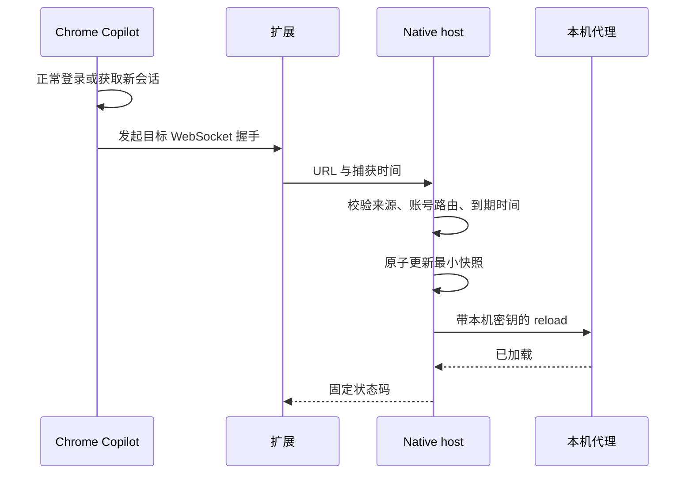

# 协议与数据流

Copilot Mac Proxy 在 macOS 上运行独立的本机 HTTP 网关。客户端使用 Messages 风格请求，上游使用实际捕获到的 Copilot Chat StreamHub/SignalR 会话。

## 请求链路

1. Claude Code 向 `127.0.0.1:19324` 发送带本机网关密钥的请求。代理拒绝非本机 Host、带浏览器 Origin 的请求及缺少认证的模型调用。
2. `envelope.mjs` 检查消息和工具结构，将 system、历史、工具定义及工具结果编码为文本。未知或不支持的内容块会失败，不会静默转换为工具执行。
3. `streamhub.mjs` 为每个请求生成新的会话与请求标识，连接固定的 TLS 上游。模型 tone 必须来自导入时已观察到的请求。
4. 上游最终文本按严格 JSON 规则解析。工具名称必须已由客户端声明；本地代理仅返回工具请求，不执行工具。
5. Claude Code 按自身权限规则执行工具，再将结果送回代理。完整上游响应解析后，代理输出 Messages 格式结果或 SSE 事件。

上游请求不附加捕获会话中的插件、连接器或历史文件。每轮发送的客户端历史仍包含在本轮文本封装中。

纯文本请求可携带 `stop_sequences`。代理先验证完整 JSON 响应封装，再在解码后的文本中找到最早匹配，删除匹配序列及其后文本，并返回对应的 `stop_reason` 与 `stop_sequence`；JSON 与 SSE 使用相同结果。未命中则保留正常结束状态，格式损坏不会被停止序列掩盖。停止序列与本地工具混用仍被拒绝，显式 JSON Schema 输出尚未实现。此适配不识别或改写自动模式分类器的允许/拒绝结果。

## 接口

| 路径 | 用途 |
|---|---|
| `GET /healthz` | 本机运行状态、缓存到期时间和活动请求数 |
| `GET /v1/models` | 当前两项模型映射，需要本机认证 |
| `POST /v1/messages` | 文本与工具封装请求，需要本机认证 |
| `POST /v1/messages/count_tokens` | 估算文本 token 数，需要本机认证 |
| `POST /_internal/reload` | 重新加载私有快照，需要本机认证 |

`healthz` 返回正常只说明本地进程运行，缓存到期时间也不能证明上游仍接受令牌。实际模型请求才验证远端授权。

## 首次导入

Chrome HAR 需要同时记录两个模型的实际 `chat_request` 帧。`session-store.mjs` 找到对应 StreamHub URL 和 tone，保留必要传输字段，移除聊天内容、响应帧、无关流量及原会话标识。

最小快照保持 HAR 形状以便加载，但不再是完整网络记录。它仍包含访问令牌和账号路由，因此属于私有运行数据，不是可发布配置。目录为 `0700`，文件为 `0600`，更新使用原子替换。

## 后续会话更新

扩展只监听 `wss://substrate.svc.cloud.microsoft/m365Copilot/StreamHub/*` 的 WebSocket 握手。native host 验证 Chrome 扩展来源、URL 形状、令牌有效期、捕获时间和已有账号路由。它只能替换令牌与已存在的会话路由字段，不导入新模型或更改已捕获的访问条件。

扩展不调用令牌刷新接口。缺少首次导入的最小快照时，native host 会拒绝更新，因为仅靠握手 URL 无法确定模型 tone。

## 浏览器内自动维护

自动维护默认关闭，可从扩展弹窗开启；无需 Codex、定时聊天任务或额外常驻脚本。Chrome 的 alarms 唤醒后台 service worker，再通过固定 native host 查询本机代理。状态回复只含进程可达性、令牌到期时间、活动请求数与固定错误状态，不含令牌、账号路由、请求内容或完整 URL。

每 5 分钟检查一次；有效期在 20 分钟以内、缺失或过期且没有活动请求时，最多每 15 分钟创建一次自己的后台维护标签页。页面访问正常 Copilot 首页，服务正常建立连接后仍由原有 webRequest 中继完成快照更新。维护尝试约 2 分钟后结束，不发聊天消息。默认模式不读取 DOM、不注入页面脚本。

15 分钟限速适用于自动尝试；弹窗的显式更新按钮可绕过时间阈值和冷却，仍受活动请求、人工接续和现存维护页限制。普通失败后退避 30 分钟；需要人工接续时停止新建页面。

扩展只管理自己创建的维护标签页。用户激活、移出原窗口或导航离开允许流程后，扩展放弃自动关闭权，要求人工接续；已有用户页面不作为自动刷新对象。登录默认转人工；仅启用下述可选功能后，允许受限的账号选择流程。失败会退避，需人工接续时不会反复生成标签页。

自动维护依赖 Chrome 运行、Mac 唤醒、网络与已有登录状态。服务被主动停止时不重启；登录过期、MFA 或服务策略变化不会被绕过。状态正常且未过期只表示本地缓存可用，不能等价于上游推理已成功；只有新到期时间晚于旧值才能标记有效期延长。

## 可选的已保存账号选择

0.3.0 增加独立、默认关闭的“自动选择已保存账号”。用户在弹窗保存完整登录邮箱，并通过 Chrome 授予可选 `scripting` 与 `https://login.microsoftonline.com/*` 权限后，扩展才会尝试此流程；撤销权限会关闭此选项。

选择仅限当前维护尝试创建的后台标签页。执行前核对页面所有权、后台状态、权限及 OAuth URL：必须是 Microsoft 登录域的指定授权路径，Copilot 公共客户端标识、返回地址和授权类型必须唯一且精确匹配。扩展将一次点击机会先写入会话状态，worker 重启也不会重复点击。

注入函数仅在顶层页面的 `ISOLATED` 环境内检查可见账号卡片，以用户填写的完整邮箱匹配唯一卡片，最多点击一次。它不读取输入框值、密码、Cookie 或页面存储，不填写表单；可编辑登录字段、MFA、验证码、授权同意、重复匹配、页面变化及用户交互均转人工。返回值仅含固定状态码，不返回页面内容或账号。

点击后的导航仅允许已核对的登录授权地址，以及 Copilot 的 `/landingv2`、`/home` 回程；回程不接受查询参数，仅允许空片段或原维护标记。只有最终回到 `/home`、观察到同一维护页的成功会话中继、本机缓存有效且页面仍在后台归扩展管理，才允许自动关闭。登录回程、其他标签页中继或本地健康状态单独出现，都不足以确认此流程完成。

此功能不是令牌刷新 API，也不会绕过登录或验证步骤。离线测试覆盖匹配、权限与页面所有权边界；新增权限下的真实页面流程尚未实测。

## 存储边界

- 仓库：源码、模板、合成测试与通用文档。
- 安装目录：运行程序、依赖、扩展和本机配置。
- 私有状态目录：最小会话快照、本机网关密钥与设置备份。
- Chrome：用户正常登录状态由浏览器与 Copilot 管理；本项目不读取 Cookie 或 refresh token。
- 扩展本地存储：`storage.local` 保存维护开关、检查/尝试时间、到期时间和固定状态；可选账号选择还保存用户输入的完整邮箱与其开关。访问范围限制为 `TRUSTED_CONTEXTS`，不使用同步存储，不把邮箱发送给 native host。维护标签页所有权与单次点击状态保存在 `storage.session`，浏览器重启后不沿用旧页面标识。不存会话 URL、令牌或聊天内容。

日志不写入令牌或完整连接 URL。native messaging 的标准输出仅用于长度前缀协议回复。manifest 中固定公钥用于使扩展 ID 稳定，不用于认证上游会话。

## 兼容边界

这是文本工具封装，不是 Anthropic 原生推理接口。工具执行依赖客户端；token 和费用信息为估算；图像、部分新协议内容块和 Responses API 均未实现。底层协议变化可能需要重新验证模型映射和消息解析。
